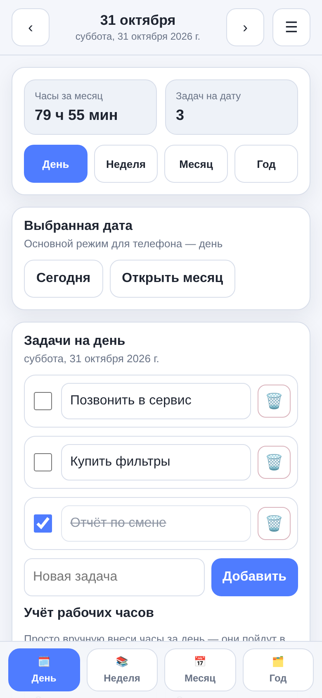
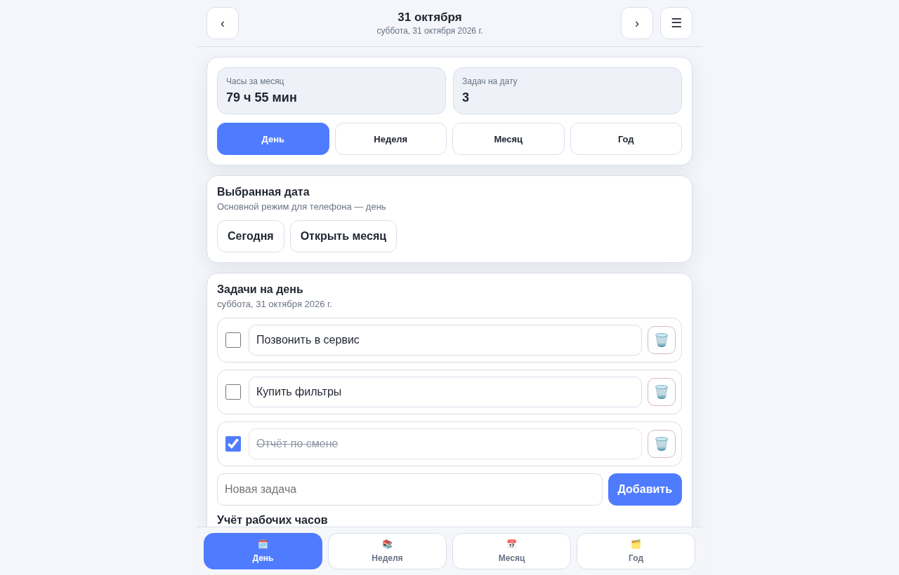
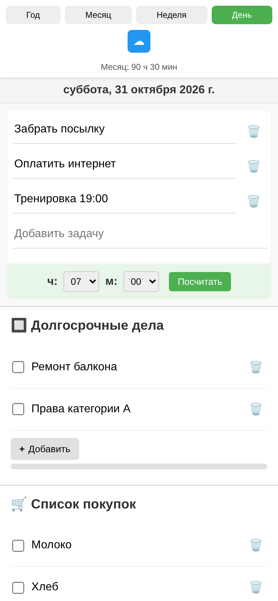
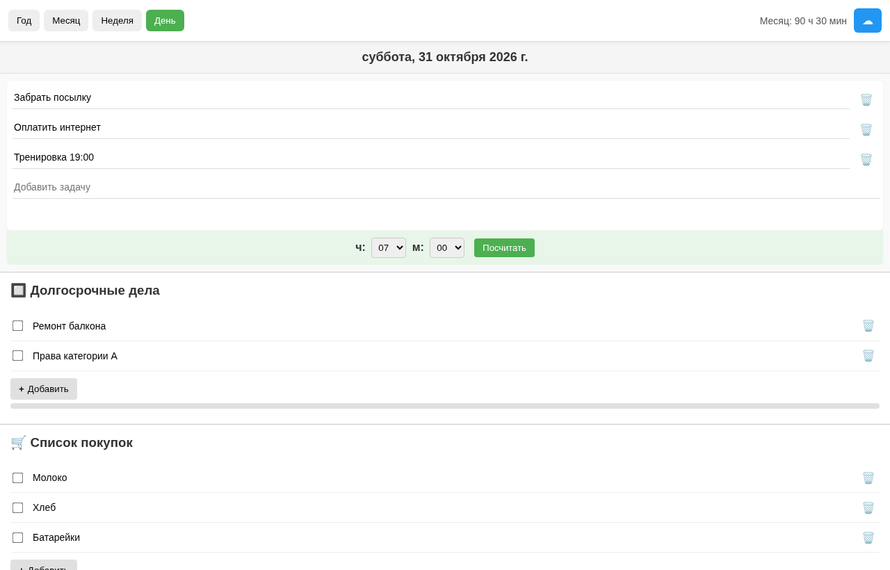
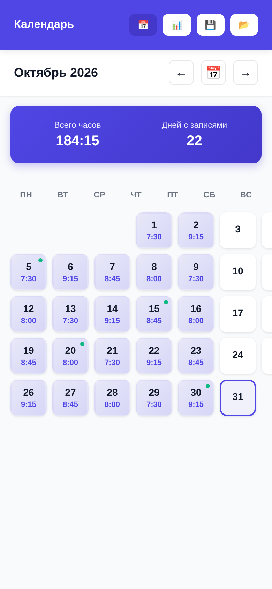
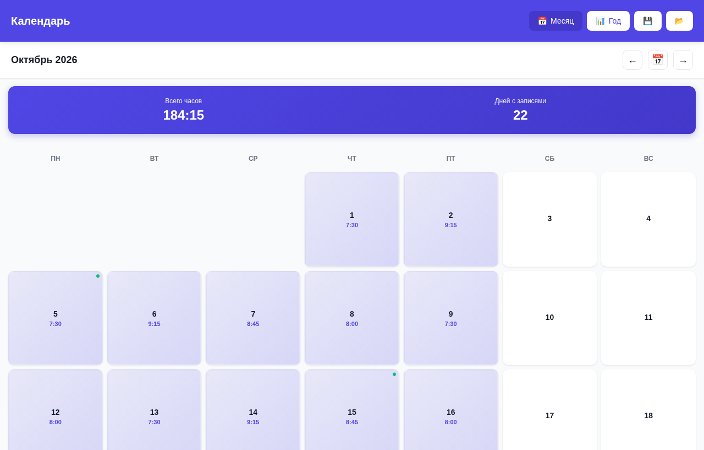

<h1 align="center">Calendars</h1>

  Три офлайн-календаря, каждый — один HTML-файл. 
  Three offline calendars, each a single HTML file.

<a href="https://finn013.github.io/Calendars/">Посмотреть онлайн / Try online</a>

---

## Планер / Planner — [`planner.html`](planner.html)
Режимы «День», «Неделя», «Месяц», «Год». Задачи на дату, учёт рабочих часов с итогом за месяц, долгосрочные дела и список покупок, экспорт и импорт JSON.
Day/week/month/year views, tasks per date, work hours with monthly total, long-term tasks and shopping list, JSON export/import.

 

## Календарь с делами / Calendar with tasks — [`calendar-tasks.html`](calendar-tasks.html)
Задачи по дням, ручной учёт часов, долгосрочные дела и список покупок, кнопка облачной синхронизации.
Daily tasks, manual hours, long-term tasks and shopping list, cloud sync button.

 

## Календарь часов / Time tracker — [`time-tracker.html`](time-tracker.html)
Месячная сетка с часами по дням, итог за месяц и число рабочих дней, годовой обзор, сохранение и загрузка файла.
Monthly grid with hours per day, monthly total and worked days, year overview, save/load file.

 

---

Хотите APK или Windows-версию какого-то календаря? [Напишите в Issues](https://github.com/Finn013/Calendars/issues) — соберём.
Want an APK or Windows build of one? [Open an issue](https://github.com/Finn013/Calendars/issues) and we’ll build it.
